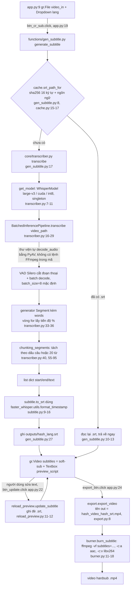

# Ghi chú Chương 8 — đọc từ mã nhánh `chau-den-bien`

## 0. Phiên bản mã được dùng

- Nhánh: `chau-den-bien`.
- Thư mục làm việc đang ở **`feae41e`**, tức là **chậm hơn `origin/chau-den-bien` (`7d26b80`) hai commit**: `4134b90` "Bỏ: thêm libx246" và `7d26b80` "thêm tính time trong gen subtitle".
- Tôi không checkout hay pull để khỏi sửa working tree. Mọi số dòng dưới đây lấy theo **`7d26b80`** bằng `git show origin/chau-den-bien:<file>`. Bản `7d26b80` chỉ khác `feae41e` ở 3 file:
  - `burner.py`: thêm `-c:v libx264` (dòng 16).
  - `transcriber.py`: bỏ `':'` khỏi `split_punctuations` (dòng 58).
  - `gen_subtitle.py`: thêm đo thời gian (dòng 16, 22, 29-32).
- Các file còn lại giống hệt giữa hai commit.
- Nếu muốn working tree khớp, chạy `git pull` (mình không chạy vì nó sửa file).
- Đường dẫn dưới đây đều tính từ `auto-subtitle/`.

## a. Sơ đồ luồng xử lý

## b. Bảng 8.3 (5 nội dung Tầng 1A)

Cột "File / commit" ghi số dòng theo `7d26b80`. Cột "Tầng" lấy theo cách gọi của đề (Tầng 1A). Nếu báo cáo của bạn đánh số tầng khác thì sửa lại cột này.

| TT | Nội dung (Phần 2) | Tầng | Dùng ở chức năng nào (Phần 3) | File / commit / version | Minh chứng / số liệu | Trạng thái |
|---|---|---|---|---|---|---|
| 1 | Luồng đầu vào audio/video | 1A | Tạo phụ đề: video người dùng chọn được đưa thẳng vào `transcribe` | `core/transcriber.py:18` `batched_model.transcribe(video_path, ...)`; `functions/gen_subtitle.py:17-21`. Thư viện `faster-whisper==1.2.1` tự gọi `decode_audio` (PyAV `import av`, site-packages `faster_whisper/audio.py:15`) khi đầu vào không phải `np.ndarray` (`faster_whisper/transcribe.py` quanh dòng 372-380). **Trong mã đồ án không có bước tách audio bằng FFmpeg trước ASR.** FFmpeg chỉ chạy ở `core/burner.py:12` để burn phụ đề vào video, không phải để lấy audio | `video_path` được truyền nguyên cho `transcribe` (`transcriber.py:18`). `grep ffmpeg` trong `*.py` chỉ ra `burner.py:12` và thông báo lỗi `export.py:14` | Dùng trong đồ án |
| 2 | Tải/chạy model (model_size, device, compute_type, singleton) | 1A | Mọi lần tạo phụ đề | `core/config.py:9-11`: `MODEL_SIZE="large-v3"`, `DEVICE="cuda"`, `COMPUTE_TYPE="int8"`. `core/transcriber.py:5` `_model = None`; `:7-11` `get_model()` khởi tạo `WhisperModel(MODEL_SIZE, device=DEVICE, compute_type=COMPUTE_TYPE)` một lần rồi dùng lại. Lưu ý: `BatchedInferencePipeline(model=model)` ở `:16` được **tạo mới mỗi lần gọi `transcribe`** (chỉ là wrapper, không tải lại model) | Môi trường kiểm tra: `ctranslate2 4.8.2`, `get_cuda_device_count()=1` trên máy này. **Chưa có số liệu VRAM/thời gian nạp model đo từ đồ án** (chỉ có `print` thời gian ở `transcriber.py:42`, không có log kết quả trong repo) | Dùng trong đồ án. Số liệu hiệu năng: [cần xác nhận] |
| 3 | Segment start/end/text: transcribe → chunking → to_srt | 1A | Tạo SRT, xem trước, sửa tay, burn | `transcriber.py:33-36` gom `Segment`; `:40` `chunking_segments`; `:55-95` định nghĩa (dict `start/end/text`, lấy mốc từ `word.start`/`word.end`, `:66-67`, `:75-79`); `:89-94` nhánh dự phòng dùng `segment.start/end/text` khi không có `words`; `core/subtitle.py:9-16` `to_srt` dùng `faster_whisper.utils.format_timestamp(..., always_include_hours=True, decimal_marker=',')` (`:12-13`); `gen_subtitle.py:27` ghi file | File mẫu `outputs/9516e5c9c553efdc_auto.srt` (1087 dòng) và `outputs/b01c6ec08040b374_auto.srt` (1243 dòng). Ví dụ trong file đầu: khối 3 chỉ có chữ "shot." (09,480 → 10,000) là dấu vết của giới hạn 20 từ/dòng. Hai file này có trong git dù `.gitignore` định loại (xem mục c) | Dùng trong đồ án |
| 4 | Tham số giải mã | 1A | Tạo phụ đề | `transcriber.py:16` `BatchedInferencePipeline`; `:18-29`: `language=language` (`None` = tự phát hiện, map ở `config.py:14-18`), `beam_size=5`, `vad_filter=True`, `vad_parameters=dict(threshold=0.6, min_silence_duration_ms=2000, speech_pad_ms=300)`, `condition_on_previous_text=False`, `word_timestamps=True`. **`batch_size` không truyền** → mặc định thư viện là **8** (`faster_whisper/transcribe.py:295`) | Đã xác minh trong mã thư viện cài sẵn: (i) `BatchedInferencePipeline` ép `condition_on_previous_text=False` bên trong (`transcribe.py:547`), nên tham số đồ án truyền là **dư, không có tác dụng thêm**; (ii) `vad_parameters` dạng dict bị thư viện bơm thêm `max_speech_duration_s=chunk_length` (`transcribe.py:404-410`); (iii) `hallucination_silence_threshold` bị đặt `None` (`:546`). Chưa có thí nghiệm đo riêng tác động từng tham số (VAD/batched/word_timestamps) → [cần xác nhận] nếu nhóm có chạy | Dùng trong đồ án. Thí nghiệm riêng: không tìm thấy trong repo |
| 5 | Xử lý lỗi ASR thường gặp | 1A | Hậu xử lý | `transcriber.py:50-51` `clean_space` (chỉ gộp khoảng trắng); `:55-95` chunking. **Không có** đoạn mã sửa lỗi nhận dạng: không lọc hallucination, không loại lặp từ, không sửa chính tả/số, không dùng `initial_prompt`/`hotwords`. Phần giảm lỗi thực tế đến từ (a) VAD `threshold=0.6` (comment `:23` nói để bớt nhận nhầm nhạc là tiếng nói), (b) `condition_on_previous_text=False` (chống lan lỗi, nhưng thực chất do pipeline batched ép sẵn), (c) người dùng tự sửa trực tiếp ở `functions/reload_preview.py:11-12` (human-in-the-loop) | Không có số liệu WER hay bộ test nào trong repo (không có thư mục test, không có script đánh giá) | Dùng trong đồ án (VAD, sửa tay). Hậu xử lý lỗi ASR tự động: **không có**. Số liệu đánh giá: **không tìm thấy** |

Các hàng phụ (ngoài 5 nội dung Tầng 1A, nếu bảng của bạn cần):

| Nội dung | File / dòng | Trạng thái |
|---|---|---|
| Cache SRT theo hash nội dung | `core/cache.py:4-9`, `:15-17`; dùng ở `gen_subtitle.py:8,10-13` | Dùng. Khóa cache chỉ gồm hash video và ngôn ngữ, **không gồm** model/tham số (cache.py:14 tự ghi chú) |
| Sửa phụ đề trực tiếp | `functions/reload_preview.py`; `app.py:22` | Dùng |
| Burn hardsub | `core/burner.py:11-18`; `functions/export.py:8,12` | Dùng. `app.py:24` |
| `functions/srt_to_text.py` | Hàm `srt_to_text`, 10 dòng | **Có mã nhưng chưa tích hợp**: không được import ở `imports.py` hay `functions/__init__.py`, không nơi nào gọi |
| Đo thời gian (`print`) | `transcriber.py:42-46`, `gen_subtitle.py:29-32` | Dùng như công cụ đo thủ công; chưa có kết quả được lưu trong repo |

## c. Mâu thuẫn / điểm cần sửa

1. **Commit.** `context.md` ghi `7d26b80`, nhưng HEAD local là `feae41e` (chậm 2 commit so với remote). Cần `git pull` trước khi chụp minh chứng "version".
2. **`requirements.txt:2` ghi `faster-whisper==1.21`.** Không tồn tại. `pip index versions faster-whisper` liệt kê 1.2.1, 1.2.0, 1.1.1, ... và không có 1.21. `pip show faster-whisper` cho **Version 1.2.1** trên máy này. Sửa thành `faster-whisper==1.2.1`; cài từ file này sẽ lỗi. Đồng thời file này thiếu `ctranslate2` (kéo theo như phụ thuộc) và các lib CUDA (cuBLAS/cuDNN) cần để chạy `cuda`; bạn nên ghi chú điều kiện này ở báo cáo [cần xác nhận cách nhóm cài].
3. **Comment `config.py:11`** `# "float16" nếu dùng GPU` **không khớp** với giá trị `COMPUTE_TYPE="int8"` đi cùng `DEVICE="cuda"` (`:10`). `int8` trên CUDA vẫn hợp lệ trong CTranslate2, nhưng comment sẽ khiến người đọc tưởng cấu hình GPU phải là float16. Nên sửa comment hoặc ghi lý do chọn int8 (tiết kiệm VRAM).
4. **Cấu hình thật so với báo cáo Chương 4** (large-v3, cuda, int8, beam_size=5): **khớp** (`config.py:9-11`, `transcriber.py:20`). Cần nói rõ thêm ba điểm mà benchmark Chương 4 không có: `BatchedInferencePipeline` với `batch_size=8` mặc định, `vad_filter=True` với tham số riêng, `word_timestamps=True`.
5. **`condition_on_previous_text=False`** (`transcriber.py:27`): trong pipeline batched tham số này bị ép `False` (`faster_whisper/transcribe.py:547`). Đừng viết trong báo cáo rằng đây là một quyết định thiết kế có hiệu lực riêng; chỉ nên nói nó nhất quán với chế độ batched.
6. **README** của nhánh không mô tả cấu hình (chỉ có tiêu đề) nên không dùng làm nguồn trích dẫn.
7. **File `gitignore` thiếu dấu chấm** (tên đúng phải là `.gitignore`), nên các luật `*.srt`, `outputs/`, `__pycache__/` không có hiệu lực. Hậu quả: `outputs/*.srt` và các `.pyc` đang nằm trong git. Dòng `M gitignore` trong git status là thay đổi chưa commit của file này.
8. **Chunking tách theo dấu câu** (`transcriber.py:58,72`) dùng kiểm tra `p in clean_word` nên có thể tách nhầm ở số thập phân hoặc viết tắt (ví dụ "3.5", "U.S."). Đây là suy luận từ đọc mã, **chưa chạy thử** → [cần xác nhận] nếu muốn đưa vào báo cáo.
9. **Khối phụ đề chỉ có 1 từ** (ví dụ khối 3 "shot.") xuất hiện khi câu dài hơn 20 từ: đây là tác dụng phụ của `max_words_per_line=20` (`transcriber.py:57`).
10. **Không có bộ test, không có bảng WER/latency/throughput trong repo.** Mục 8.2 theo track AI/Data sẽ phải dựa vào số bạn tự đo thêm (xem phần "còn thiếu" bên dưới).

## d. Gợi ý dàn ý 8.1 (kiến thức → quyết định → sản phẩm)

Lưu ý khi viết: benchmark Chương 4 chạy trên `WhisperModel` thuần (không VAD, không batching, không word_timestamps), còn mã đồ án dùng cấu hình khác. Vì vậy **chỉ chuyển "xu hướng"** từ benchmark sang đồ án (ví dụ: model lớn chính xác hơn, int8 giảm VRAM mà chất lượng giảm ít), **không chuyển con số tuyệt đối**. Nếu muốn có số, phải đo lại trên pipeline của đồ án.

1. **Đầu vào audio/video**
   - Kiến thức: faster-whisper nhận đường dẫn file và tự giải mã về 16 kHz mono (PyAV).
   - Quyết định: bỏ bước tách audio bằng FFmpeg (khác nhánh `main`), truyền thẳng video.
   - Sản phẩm: `transcriber.py:18`. FFmpeg chỉ còn dùng cho hardsub (`burner.py`).
   - Thí nghiệm hỗ trợ: [cần xác nhận] nhóm có so sánh thời gian "có/không tách audio" không; nếu có thì ghi lại, nếu không thì chỉ nêu là quyết định đơn giản hóa.
2. **Model và độ chính xác số học**
   - Kiến thức: kích thước model, device, compute_type, đánh đổi VRAM/tốc độ/chất lượng (mục 4.2.3 của bạn).
   - Quyết định: `large-v3` + `cuda` + `int8`.
   - Sản phẩm: `config.py:9-11`, `get_model()` singleton (`transcriber.py:7-11`) để tránh nạp lại model mỗi request (phù hợp `demo.queue(default_concurrency_limit=1)`, `app.py:26`).
   - Ghi rõ: benchmark chỉ cho xu hướng; sửa comment `config.py:11` cho khớp.
3. **Segment và timestamp**
   - Kiến thức: `Segment(start, end, text)` và `words` (word_timestamps).
   - Quyết định: không dùng segment gốc làm dòng phụ đề mà dựng lại từ mốc từng từ.
   - Sản phẩm: `chunking_segments` (tách theo dấu câu hoặc 20 từ) → `to_srt` với `format_timestamp` của thư viện (commit `feae41e`: bỏ hàm tự viết `format_timestamps`).
   - Minh chứng: file `.srt` trong `outputs/`.
4. **Tham số giải mã**
   - Kiến thức: beam search, VAD, tính độc lập giữa các đoạn, batched inference.
   - Quyết định: `beam_size=5`, VAD `threshold=0.6`, `min_silence_duration_ms=2000`, `speech_pad_ms=300`, batched với `batch_size` mặc định 8.
   - Sản phẩm: `transcriber.py:16-29`.
   - Thí nghiệm hỗ trợ: Chương 4 chỉ hỗ trợ `beam_size` và model/compute_type. VAD và batched là quyết định **chưa có thí nghiệm riêng trong repo**; hãy trung thực nêu là chọn dựa trên tài liệu/khuyến nghị và quan sát thủ công (nếu đúng), hoặc đo bổ sung.
5. **Lỗi ASR**
   - Kiến thức: hallucination trên đoạn nhạc/im lặng, lặp từ, lan lỗi giữa các đoạn.
   - Quyết định: giảm nguồn lỗi ở gốc (VAD, tắt conditioning) và để người dùng sửa tay thay vì hậu xử lý tự động.
   - Sản phẩm: VAD `transcriber.py:21-26`, `reload_preview.py`, cache `cache.py`.
   - Nêu rõ giới hạn: không có hậu xử lý tự động và chưa có WER.

## Còn thiếu (cần bạn bổ sung)

- Số liệu cho 8.2 (track AI/Data): không có bộ test, WER, latency hay throughput nào trong repo. Phần duy nhất đo được là các dòng `print` (`transcriber.py:42-46`, `gen_subtitle.py:31-32`): thời gian nạp model, thời gian suy luận và "x realtime". Cần chạy lại trên video mẫu (có kèm độ dài video, GPU) rồi chép số vào.
- Bộ dữ liệu và transcript chuẩn để tính WER, nếu nhóm muốn có độ chính xác.
- Xác nhận nhóm có thí nghiệm riêng cho VAD, batched, word_timestamps hay không (mục b hàng 4).
- Xác nhận phiên bản dùng khi chụp minh chứng: `1.2.1` thật, và `git pull` về `7d26b80`.
